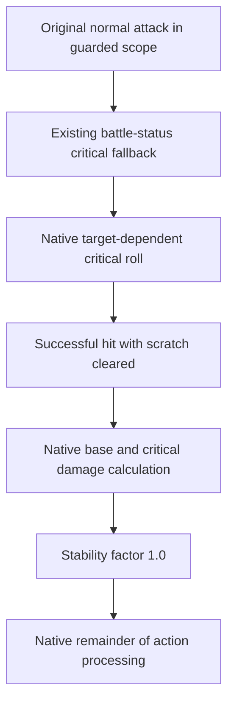

# Stability + Crit Settings: implementation and acceptance analysis

Analysis date: 2026-10-19, Asia/Jakarta. Command 73 / F2, source version 0.95.1.

## Finding

The feature modifies accuracy, stability and critical-selection inputs before the
normal action finishes calculating damage. The active forwarding callbacks retain
the native calculation arguments and results. At the Native multiplier setting,
the game also supplies its original critical-damage multiplier.

This explains the internally consistent clean critical hits seen in the recorded
comparisons. Accepted melee damage and completed fights are recorded observations;
the precise reason the remote server accepts those results is an inference. The
available implementation and captures contain no recovered server validation
algorithm.

This analysis used current project source, the two supplied screenshots, saved
native disassembly, existing gameplay records and offline core tests. It did not
control the game, inspect a running process, change hooks or rebuild release
binaries. Statements about earlier processes describe saved evidence.

## What the screenshots establish

The HIT=10,000 image agrees with the active getter override; the HIT=35 image
agrees with an unmodified getter. No toggle telemetry accompanies the images,
so this association comes from the displayed value and implementation.

| Displayed property | HIT=35 image | HIT=10,000 image |
|---|---:|---:|
| HIT | 35 | 10,000 |
| ATK | 211 | 211 |
| MATK | 36 | 36 |
| DEF / MDEF | 57 / 57 | 57 / 57 |
| FLEE | 33 | 33 |
| ASPD / CSPD | 76 / 36 | 76 / 36 |
| STR | 80 | 80 |
| MaxHP / MaxMP | 442 / 332 | 442 / 332 |

`hk_hit_10000` returns exactly 10,000. Command 73 installs that callback on
`PlayerBattleStatus.get_Hit` and `PlayerSecondaryStatus.get_Hit`, explaining the
visible change without editing primary STR or ATK. These calculator getter hooks
apply at the class level, including UI readers. The critical fallback described
below has additional local-instance and caller guards.

The screenshots contain no stability/critical values, combat HP transitions or
server acknowledgements. Their direct evidence is the displayed stat comparison.

## Active implementation

The active table in `crates/wcore/src/features.rs:2194` contains 19 hook entries,
using 19 of the 24 allocated entries in `ALWAYS_CRIT_HOOKS`.

| Component | Active behavior | Source |
|---|---|---|
| Battle/secondary critical getters | Return integer 1,000 | `features.rs:214`, table at 2203 |
| Battle/secondary main/sub stability getters | Return integer 100 | `features.rs:227` |
| Battle/secondary accuracy getters | Return integer 10,000 | `features.rs:270` |
| Normal-action `CheckHit` | Return true and clear the output scratch flag | `features.rs:394` |
| Normal-action inherited `CalcStable` | Return float 1.0 | `features.rs:231` |
| Normal-action calculation wrapper | Enter a thread-local scope, call original, count execution | `features.rs:833` |
| PlayerStatus secondary getter | Select a validated existing battle-status fallback for one caller | `critical_path.rs:249` |
| Battle/secondary critical-damage getters | Forward original; optionally select 175/200/250/300 | `features.rs:244` |
| Base damage and base action wrappers | Forward original arguments/results | `features.rs:433`, 817 |
| Three critical-check helper entries | Return true when reached through their replaced pointers | `features.rs:2262` |

### Maximum stability and clean hits are separate controls

Stability getters report 100 in integer percentage units. The inherited
`CalcStable` method returns a fractional multiplier, and its callback returns
**1.0**, representing 100% stability. Saved native inspection established that
the normal attack dispatches this method through its derived class vtable.

The checked physical and magic stability helpers divide their integer result by
100.0. Returning 100.0 from this callback would therefore use the wrong units.
The current callback supplies the maximum ordinary stability factor.

`CheckHit` has two distinct outputs: its Boolean return indicates success, while
the `out bool correct` parameter becomes `DamageData.IsScratch`. The successful
native accuracy branch returns true and writes false to that parameter. The mod
does the same, after checking that the output byte is writable.

Saved instructions show that a true scratch flag can also halve the input
stability before the later native stability calculation. The current callback
clears the flag at its source, before the native damage record copies it.

These controls remove stability-roll reduction and the scratch classification
on the reached normal-attack path. Proration, defense, other native terms and
rounding can still vary final damage between attacks.

### The critical-selection fallback closes a direct-call gap

The original normal attack obtains a secondary-status object, casts it to
`PlayerSecondaryStatus`, and directly calls `GetCrtRate`, `GetCrtConstant` and
`CalcCritical`. Those calls skip the hooked `get_Critical` getter. It also
directly calls the original `checkCriticalPercent`, skipping that helper's
MethodInfo replacement.

The implemented solution uses an existing native alternative branch:

1. `hk_naa_calc_mob_dmg` enters `NormalAttackScope` only around the original
   normal-attack calculation.
2. The secondary-getter shim captures the caller return address before a Rust
   prologue changes the stack.
3. For the configured local PlayerStatus, on that thread and at the validated
   caller `original_naa + 0x27B`, the callback returns the existing battle-status
   object. It leaves the stored secondary-status pointer and object fields intact.
4. That object fails the native `PlayerSecondaryStatus` cast. The original action
   follows its fallback through `IPlayerStatusCalculator.get_Critical`, which
   resolves to the patched battle-status getter returning 1,000.
5. The original target-dependent critical check and random roll still execute.
   Their Boolean selects the native hit type before base damage is calculated.

`critical_path::prepare` validates object classes, field layout, getter body,
four native instruction blocks and resolved call/global targets. Rejected or
unrelated getter calls forward to the original. Essential hook failures roll
back installation, and disabling first turns off fallback selection.

The requested rate of 1,000 explains the consistent observed critical results
while the native resistance/roll stage remains active. It is not a recovered
universal probability formula. The three helper hooks have no vtable slot in the
saved installation logs; their installation alone does not establish skill
coverage. The demonstrated normal-attack mechanism is the scoped fallback.

### Native damage remains the calculation owner

`hk_calc_base_damage` passes through the native critical Boolean, action pointers,
attack/equipment arguments and MethodInfo, returning the original numeric result.
`hk_naa_calc_mob_dmg` similarly forwards the original action calculation.

The Native multiplier selection is stored as zero. Active critical-damage hooks
call the original getter and return its result unless an explicit supported
custom percentage is selected. Native does not impose a fixed 150 or 300:
150 is only the unavailable-original fallback. The old `hk_crit_dmg_300` helper
exists but is absent from command 73's active hook table.

Saved native instructions show critical damage reading the calculator getter,
dividing its integer result by 100, then applying that fraction during damage
calculation. Custom multiplier commands therefore change a real calculation
input, but the successful saved comparisons used Native and do not validate
every custom setting.

Legacy `force_critical_on_action`, `stamp_skill_damage_data`, `hk_hit_type_2` and
`hk_reaction_0` helpers remain in the source. A workspace reference search found
no active production caller for the stamping entry point; its remaining external
calls are null-input tests. Command 73 does not install packet getter overrides,
perform MP/HP refills, or rewrite completed damage through those helpers.

The normal attack's private/static base-damage calls skip the installed virtual
base-damage wrapper. This agrees with saved `base_damage_calls=0` while normal,
stability, clean-hit and critical-fallback counters all increase.

## Why the observed acceptance is plausible

The verified local sequence is:

The code gives the native action mutually consistent early inputs. Critical
classification precedes critical damage, scratch is cleared before its damage
record is created, and stability uses the correct fractional units. Native
equipment/base-damage calculations and subsequent action processing continue.
Command 73 itself leaves distance handling, skill payment, primary stats, received
HP/MP caches and proration unmodified.

This is a supported client-side explanation for the consistent observed fights.
It does not establish whether the server trusts a particular transmitted field,
independently recalculates some terms, allows particular tolerances, or performs
additional checks. No packet capture or server implementation in this analysis
resolves those alternatives. Hook pointer mechanics explain interception and
restoration; they do not explain remote combat acceptance by themselves.

## Recorded execution and outcomes

| Saved comparison | Execution evidence | Gameplay outcome recorded |
|---|---|---|
| PID 4600, combined correction | 13 normal calculations, 13 stability calls, 13 hit checks, 13 critical fallbacks; base-damage wrapper 0 | Operator reported all tested normal hits critical, no Graze, lasting damage, Boss Colon victory/rewards |
| PID 19224, v95.1 melee comparison | Six each of normal calculations, stability, hit checks and critical fallbacks; base-damage wrapper 0 | Operator reported faster melee, no Graze and lasting normal/Hard Hit damage |

Both saved combined comparisons used modes 72/73 with Native multiplier; MP and
range were off. Earlier PID 16588 observations also record lasting Hard Hit
damage with command 73 on while timing/MP overrides were off. These distinguish
command 73's behavior from the separate timing feature while retaining the
operator-reported nature of those gameplay outcomes.

Offline reinspection of `work/hp-final-4600.jsonl` found 173 target samples. Many
reductions converge to the client's cached `server_hp`. The terminal samples
include local HP 0 / cached HP 227 beginning at 29,239.8 ms and local/cached HP
227/227 at 29,443.9 ms, followed by target loss. This is one upward local
transition, about 204.1 ms after the first zero. Its cause was not recovered.
The separate victory/rewards report remains recorded; the trace is not a direct
server query and does not establish a correction-free fight.

The new screenshots and current operator report add evidence of the observed
working behavior. Their current game process, loaded core hash, toggles and
multiplier selection were not independently identified in this analysis.

## Verification and source identity

`cargo test -p wcore`: **47 passed, 0 failed**, including:

- Full argument/native critical-choice forwarding.
- No post-calculation damage relabeling or rescaling.
- Correct one-byte scratch clear with adjacent bytes preserved.
- Fractional stability units.
- Native multiplier forwarding and non-compounding custom selections.
- Critical fallback instance/caller/thread/nesting guards and original forwarding.
- Hook original publication, derived vtable handling and restoration behavior.

These are deterministic implementation checks, not new server acceptance tests.
The suite's simulated worker panic is an expected passing isolation test.

Inspected source started clean at Git HEAD
`5d823078bfad1f28d5664487edb96dc04ee73e5a`. Current on-disk core SHA-256:
`733F4C16495C90A1B8D5744A13CAF077BE9CFB1F6A6E153A3B8C111A903E87CD`.
The historical captures use earlier core artifacts documented in their records.

## Evidence locations

- [Current hook table and callbacks](../crates/wcore/src/features.rs).
- [Scoped native critical selection](../crates/wcore/src/critical_path.rs).
- Native signatures, dispatch and scratch semantics (development repository).
- [v94 gameplay comparison and HP-trace limits](V94_VALIDATION.md).
- [v95.1 focused melee comparison](V951_VALIDATION.md).
- Saved logs: `work/v94-live-4600.log`, `work/v951-live-19224.log`.
- Saved HP data: `work/hp-final-4600.jsonl`.
- Saved native instruction files inspected outside the repository:
  `%TEMP%/combat-readonly-4672/checkCriticalPercent.txt`,
  `%TEMP%/combat-readonly-4672/CriticalMultiplierSegment.txt`, and
  `%TEMP%/combat-readonly-13520/checkPercent.txt`.
